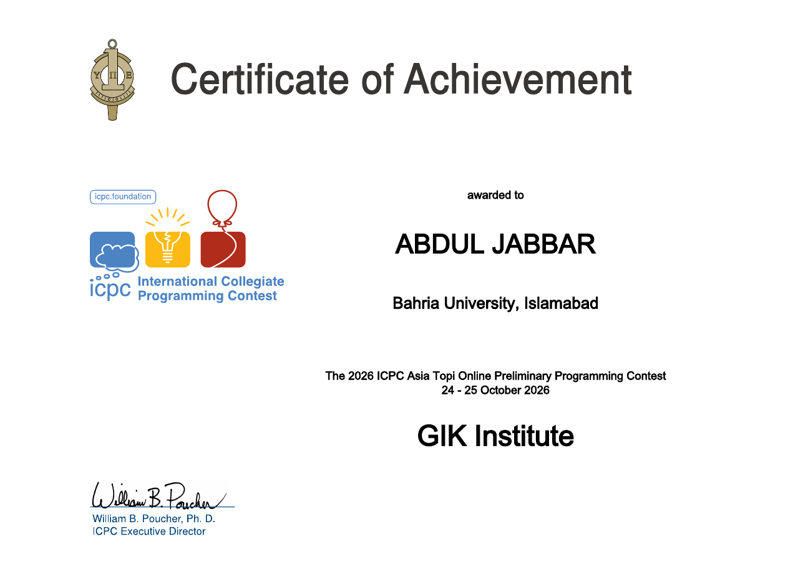
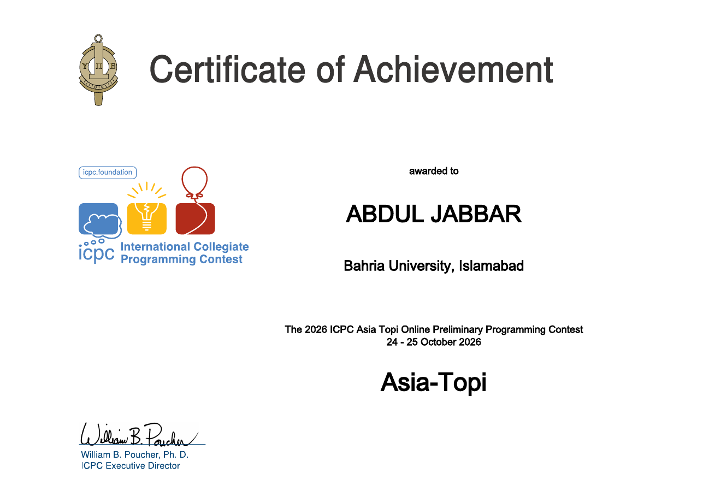

<!-- ========== HEADER ========== -->
<div align="center">


<a href="https://git.io/typing-svg">
  
</a>

<br/>


</div>

---

## 👨‍💻 &nbsp;About Me

```js
const sikandar = {
  name: "Abdul Jabbar Sikandar",
  role: "BSCS Student & Full-Stack Developer",
  university: "Bahria University, Islamabad 🇵🇰",
  achievements: ["ICPC Asia Topi 2026 Online Preliminary: Rank 17 in Pakistan 🏆", "Ex-House Captain, Bahria College"],
  skills: ["MERN", "C++ & OOP", "App Dev", "3D Design", "Digital Marketing"],
  currentFocus: "Building scalable products + long-term income streams",
  funFact: "I design 3D, run ads, and ship code. All in one. ⚡"
};
```

---

## 🏆 &nbsp;Achievements

<div align="center">

| 🥇 Achievement | 📅 Date | 📍 Details |
|---|---|---|
| **ICPC Asia Topi 2026, Online Preliminary** | 24-25 Oct 2026 | Rank **17** in Pakistan · Certificates of Achievement · Bahria University, Islamabad |
| **Zafar House Captain & Council Member** | Bahria College | Student leadership |

<br/>




</div>

---

## 🚀 &nbsp;Now Building

| 🔥 Project | 📌 Status |
|---|---|
| **Email Automation SaaS** for Pakistani SMBs | 🟢 In development |
| **Luxury digital design assets**, my digital products business | 🟢 Live & growing |
| **FiveM scripts & digital products** | 🟡 Learning & prototyping |
| **3D Portfolio Website** | ✅ [Live here](https://aj-portfolio-mysite.vercel.app) |

---

## 🛠️ &nbsp;Tech Arsenal

### 🌐 Frontend


### ⚙️ Backend & Database


### 🧠 C++ / OOP / Competitive Programming


### 📱 App Development & 🎨 3D Design


### 📈 Digital Marketing & E-commerce


### 🧰 Tools


---

## 📊 &nbsp;GitHub Stats

<div align="center">


<br/>


</div>

---

## 🐍 &nbsp;Contribution Snake

<div align="center">
  <picture>
    <source media="(prefers-color-scheme: dark)" srcset="https://raw.githubusercontent.com/sultansikandar1024-crypto/sultansikandar1024-crypto/output/github-contribution-grid-snake-dark.svg" />
    
  </picture>
</div>

---

## 📂 &nbsp;Featured Projects

<table>
<tr>
<td width="50%" valign="top">

### 🌐 3D Portfolio Website
Interactive 3D IT portfolio built to showcase my work.

`HTML` `CSS` `JavaScript` `3D`

[🔗 Live Demo](https://aj-portfolio-mysite.vercel.app)

</td>
<td width="50%" valign="top">

### 📧 Email Automation SaaS
Full-stack email automation platform for Pakistani SMBs.

`React` `Node.js` `MongoDB`

[🔗 Repo](https://github.com/sultansikandar1024-crypto/YOUR-REPO-NAME)

</td>
</tr>
<tr>
<td width="50%" valign="top">

### 🛍️ Digital Products Business
Luxury digital design assets with brand and product work.

`Branding` `Digital Products` `E-commerce`

</td>
<td width="50%" valign="top">

### 🧩 Your Next Project
Add your C++ GUI app or mobile app here.

`C++` `Qt` `App Dev`

[🔗 Repo](https://github.com/sultansikandar1024-crypto/YOUR-REPO-NAME)

</td>
</tr>
</table>

---

## 🌐 &nbsp;Let's Connect

<div align="center">

[](https://aj-portfolio-mysite.vercel.app)
[](https://www.linkedin.com/in/abdul-jabbar-4b23a2372)
[](https://www.instagram.com/a_jabbar_sikandar)
[](mailto:sultansikandar1024@gmail.com)

<br/>


**⭐ If you like my work, drop a star. Let's build something great together!**

</div>
